# Bucketeer — Architecture

This document is the canonical architectural reference: how the host
app, the BucketeerCore Swift package, and the File Provider extension
fit together; how the four sync-routing paths land; how the entitlement
state machine moves; where the provisioning identifiers live; and how
the Phase 13.x feature block layers on top. The per-release history is
in [`CHANGELOG.md`](../CHANGELOG.md).

---

## 0. Feature overview (user level)

What a user can do in Bucketeer 1.0 and which tier it belongs to. Pro
features are gated in code through `EntitlementManager.isUnlocked(_:)`
(`mountDrive`, `syncEngine`, `s3ToS3Copy`, `menubarBackground`);
everything else is in the Free tier.

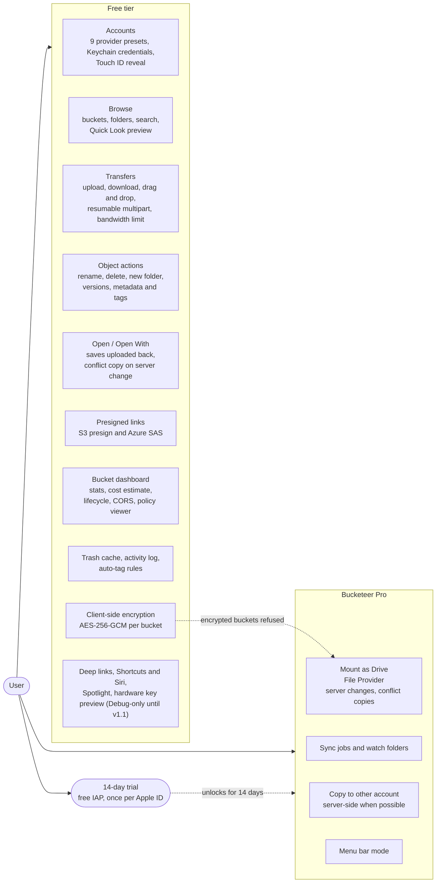

---

## 1. Module composition

Bucketeer ships as one Mac App Store binary made of three buildable
units. `BucketeerCore` is the seam everything cross-cuts on; the host
and the (yet-to-be-target-wired) File Provider extension both link it.

```mermaid
graph LR
    subgraph BucketeerCore["BucketeerCore<br/>(local Swift package)"]
        Models["Models<br/>S3Account · S3Provider · S3Object · S3Page<br/>AccountCredentials · BucketeerError · TransferTask<br/>SyncJob · S3AccountRecord · ActivityEntry<br/>ObjectVersion · ObjectMetadata · BucketStats<br/>BucketInsights · TrashedItem · MultipartUploadCheckpoint<br/>AutoTagRule · BucketEncryptionKey"]
        S3Layer["S3 layer<br/>S3ClientFactory (actor) · S3Service<br/>S3ResumableUploader (Phase 13.10)<br/>via SotoS3"]
        AzureLayer["Azure layer<br/>AzureSharedKeySigner · AzureRequestBuilder<br/>AzureListXMLParser · AzureCredentialsCache<br/>AzureBlobObjectStore · AzureBlobTransporter<br/>AzureSASBuilder"]
        Storage["Persistence (all @ModelActor)<br/>KeychainStore · AccountStore · ActivityLogStore<br/>TrashStore · CheckpointStore · AutoTagRuleStore<br/>EncryptionKeyStore · SyncJobStore"]
        Sync["Sync helpers<br/>SyncPlanner (pure) · LocalFolderEnumerator<br/>LocalFolderWriter (incl. safeChildURL)<br/>LocalFolderWatcher (FSEvents)"]
        Routing["Routing<br/>ProviderRouter (S3Browsing facade)"]
        Trial["Entitlements<br/>ProAccessResolver (pure, transactions + now)"]
        OpenWithCore["Open With + Finder changes<br/>OpenWithRoundTrip (actor) · OpenWithWorkspace · ConflictCopyName<br/>FinderChangeTracker (actor) · FinderChangeState (pure) · ETag"]
        Crypto["Encryption (13.15)<br/>BucketeerEnvelope (AES-GCM + AAD)<br/>EncryptionError"]
        AutoTag["Auto-tagging (13.8)<br/>AutoTagRuleEvaluator (pure, glob+MIME)"]
        Stats["Stats (13.5)<br/>BucketStatsCollector · ProviderPricing"]
        Bandwidth["Throttling (13.2)<br/>BandwidthLimiter (token bucket)"]
        DeepLink["Deep link (13.11)<br/>BucketeerDeepLink"]
        Env["AppEnvironment + ServiceProtocols"]
    end

    subgraph HostApp["Bucketeer.app<br/>(host target)"]
        Container["AppContainer<br/>@MainActor @Observable composition root<br/>+ static .shared for App Intents"]
        ViewModels["ViewModels<br/>AccountList · Browser · TransferQueue · SyncJobList<br/>ActivityLog · Trash · BucketDashboard<br/>ObjectVersions · ObjectMetadata · AutoTagRules<br/>EncryptionKeys"]
        Views["SwiftUI Views<br/>Sidebar · Browser · Sync · Paywall · Menubar · About<br/>Activity · Trash · Settings (General · Transfers · Rules<br/>· Encryption · Security · Pro)"]
        HostOnly["Host-only services<br/>EntitlementManager (StoreKit) · MountController<br/>DragDropCoordinator · TransferManager (actor)<br/>SyncEngine (actor) · SyncStatusBroker (multicast)<br/>PreviewCache · AppActivationController<br/>TrashCoordinator · BandwidthSettings · TrashSettings<br/>AutoTagCoordinator · DeepLinkRouter · CrossAccountCopyCoordinator<br/>SpotlightIndexer · SpotlightSettings · BucketEncryptionGate<br/>HardwareKeyAvailability · HardwareKeySettings<br/>OpenWithController · OpenWithTransferRemote · FileChangeWatcher"]
        AppIntents["App Intents (13.12)<br/>AccountEntity · AppIntentsBridge<br/>ListBucketsIntent · GeneratePresignedURLIntent<br/>UploadFileIntent · RunSyncJobIntent<br/>BucketeerShortcuts (AppShortcutsProvider)"]
    end

    subgraph FPExt["Bucketeer File Provider.appex<br/>(manual Xcode target — PHASE_9_SETUP.md)"]
        FPCallbacks["NSFileProviderReplicatedExtension callbacks<br/>FileProviderExtension · FileProviderEnumerator<br/>FileProviderItemResolver · S3DirectFetch<br/>FinderChangeTracker.shared"]
        FPContainer["ExtensionContainer (Sendable)"]
    end

    HostApp -- "import BucketeerCore" --> BucketeerCore
    FPExt -- "import BucketeerCore" --> BucketeerCore

    Container --> ViewModels
    Container --> HostOnly
    Container --> AppIntents
    HostOnly -- "uses" --> S3Layer
    HostOnly -- "uses" --> AzureLayer
    HostOnly -- "uses" --> Storage
    HostOnly -- "uses" --> Sync
    HostOnly -- "uses" --> Routing
    HostOnly -- "uses" --> Crypto
    HostOnly -- "uses" --> AutoTag
    HostOnly -- "uses" --> Stats
    HostOnly -- "uses" --> Bandwidth
    HostOnly -- "uses" --> DeepLink
    HostOnly -- "ProAccessResolver" --> Trial
    HostOnly -- "OpenWithRoundTrip" --> OpenWithCore

    FPCallbacks --> FPContainer
    FPCallbacks -- "FinderChangeTracker, ConflictCopyName" --> OpenWithCore
    FPContainer --> Storage
    FPContainer --> S3Layer
    FPContainer --> AzureLayer
    FPContainer --> Routing
```

**Why this layout:** the design spec §3 wanted shared `Models` + `Services`
between host and extension. Phase 9.5 extracted them into
`BucketeerCore` so neither side duplicates code and a test target can
hammer the storage / network / signing / encryption surface without a
UI. The 13.x block keeps adding to Core whenever the logic is
deterministic / unit-testable (planner, evaluator, envelope,
fingerprint, deep-link parser) and to the host whenever it depends on
live state (transfer manager, coordinators, view models).

### 1.1 SwiftData container topology

The host now owns **six** SwiftData containers. The shared App Group
container is read by the File Provider extension; everything else stays
host-private so the extension never has to load schemas it has no use
for. Both processes open the shared store with the one schema defined
in `SharedStore` (Core); the extension opens it with
`allowsSave: false`. A process opening it with a subset of the schema
would migrate the missing entity away.

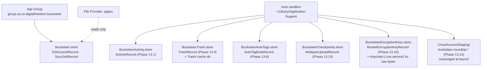

The 5 host-only stores live in the sandbox so each can grow / shrink /
purge independently. None of them are needed by the extension's
mount-callbacks path. Auto-purge runs on launch for the activity log
(180 days), the trash (user-configured retention, default 30 days),
and the cross-account staging directory (any leftover file).

### 1.2 Service-protocol seam

`BucketeerCore/Services/ServiceProtocols.swift` is the boundary
between services and the rest of the app. View models depend on
the *protocols*, not the concrete services — this lets the test
suite swap in fakes, lets `ProviderRouter` fan one `S3Browsing`
call out to either `S3Service` (Soto) or `AzureBlobObjectStore`,
and keeps the host / extension on the same contracts.

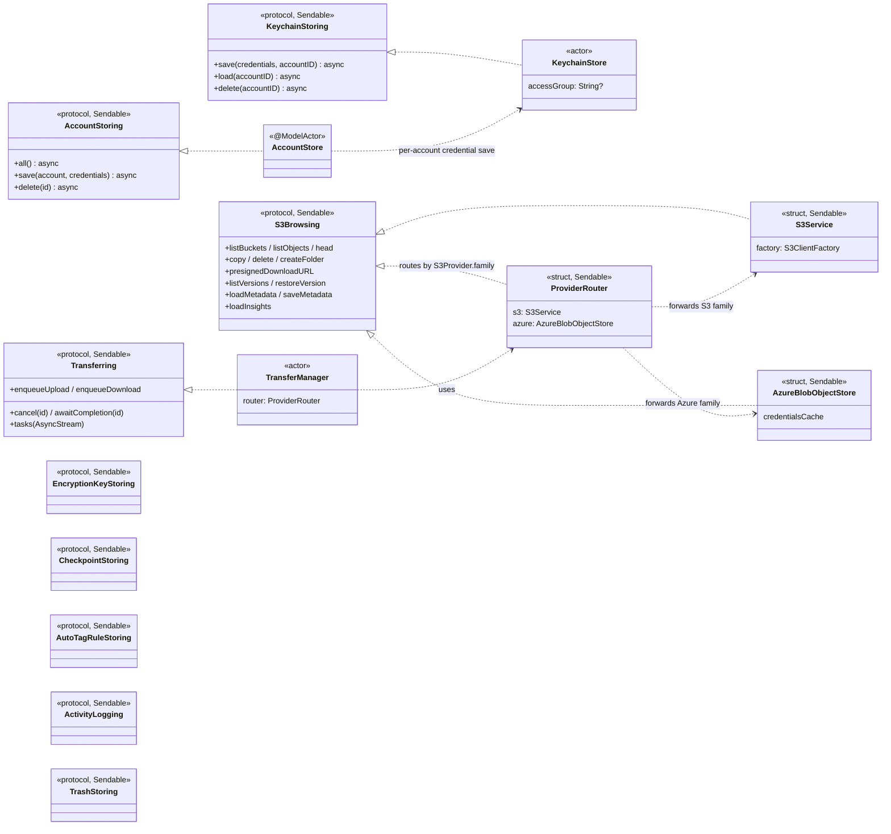

### 1.3 Sendable snapshot ↔ `@Model` record pairing

Six pairs follow a strict pattern: a Sendable value-type
"snapshot" is the only thing that crosses actor / `ModelActor`
boundaries; the `@Model` reference-type record stays inside the
SwiftData container. View models read snapshots; stores convert.
This is what lets the host enforce Swift 6 strict concurrency
without leaking SwiftData's reference semantics into the UI.

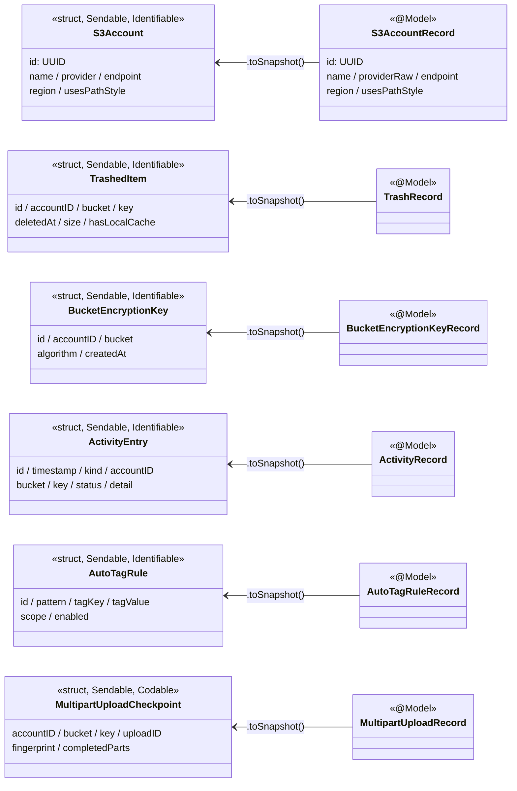

`SyncJob`, `S3Bucket`, `S3Object`, `ObjectMetadata`,
`ObjectVersion`, `BucketStats`, `BucketInsights`, `TransferTask`
and `BucketeerError` are also Sendable value types but have *no*
record sibling — they are either network-side reads
(`S3Bucket`/`S3Object`/`ObjectVersion`), per-run state
(`TransferTask`/`BucketStats`), or persisted by their own store
in a different way (`SyncJob` is `Codable` to JSON in
`SyncJobStore`).

### 1.4 External entry points: `bucketeer://` and App Intents

Deep links are parsed in Core (`BucketeerDeepLink`, pure, unit-tested)
and routed in the host by `DeepLinkRouter`. URLs arrive through
SwiftUI's `.onOpenURL` or, in menu bar mode where that can be
bypassed, through the `kAEGetURL` Apple Event handler, which re-posts
them as `bucketeerDeepLinkReceived`. A route token drops navigations
that a newer link has overtaken. App Intents never touch the UI: they
wait up to 5 s for `AppContainer.shared` through `AppIntentsBridge`
and call the same services the view models use.

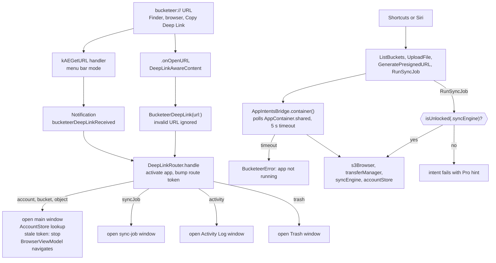

---

## 2. Sync routing — Phase 9.8 four-way matrix

Each side of a `SyncJob` is one of two cases:

```swift
public enum SyncEndpoint: Codable, Hashable, Sendable {
    case s3(accountID: UUID, bucket: String, prefix: String)
    case localFolder(bookmark: Data, displayPath: String)
}
```

`SyncEngine.execute(upsert:job:context:)` switches over
`(job.source, job.destination)` and routes to one of four execution
paths. Local-folder sides resolve their security-scoped bookmark
once per run (start before the loop, guaranteed `stop` via `defer`).

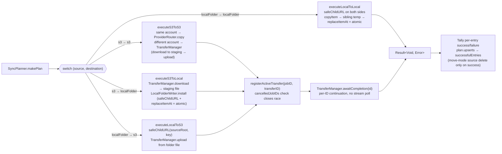

**Sandbox lifecycle for local-folder endpoints:**

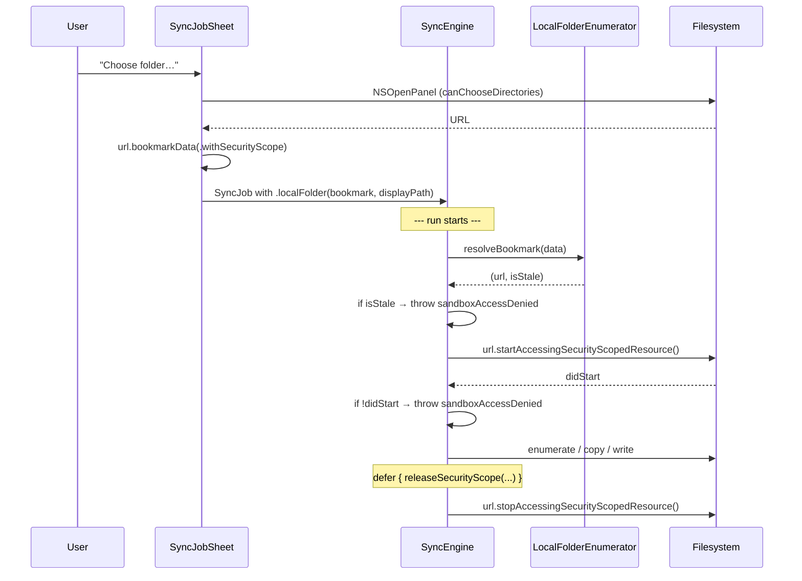

**Status fan-out — `SyncStatusBroker`:** `SyncEngine.statuses`
is an `AsyncStream<[SyncJobStatus]>` and its iterator only
delivers each emission to *one* awaiter. As soon as the sync
list view model and the `bucketeer://sync/<id>` detail window
both want to read, they need a multicaster. `SyncStatusBroker`
(`@MainActor @Observable`) is the single consumer: it owns one
pump task, normalises each snapshot to `[UUID: SyncJobStatus]`,
and republishes via its `@Observable` property. View models and
windows read `broker.statuses[jobID]` directly — SwiftUI's
observation tracking re-renders them when the broker's snapshot
changes. The pump-task handle is held `nonisolated(unsafe)` so
`deinit` can cancel it without a main-actor hop.

---

## 3. File Provider replicated-extension contract

The extension lives at `Bucketeer File Provider/`. One
`NSFileProviderDomain` per mounted bucket, identifier
`"<accountID>::<bucket>"`. Every callback is bridged through
`Progress.cancellationHandler` so Finder cancellations actually stop
the network traffic.

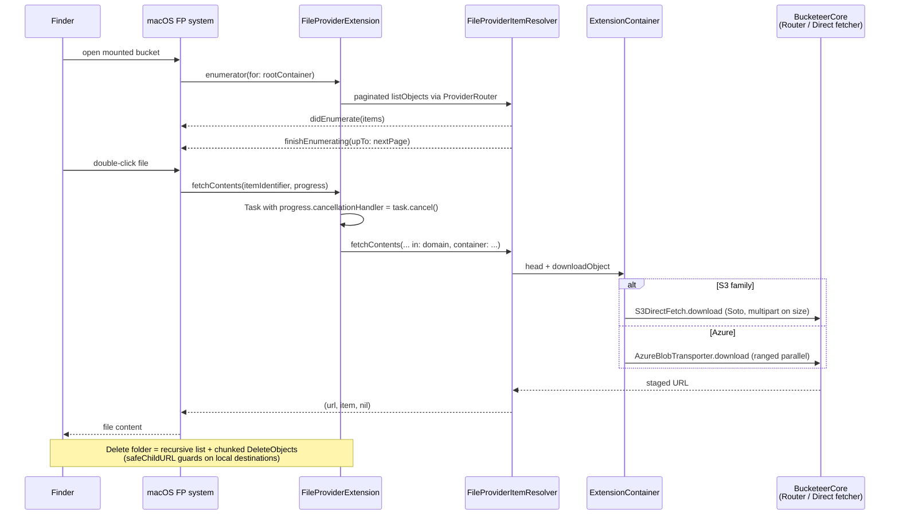

**Capability rules per item type**:

| Item | Capabilities |
|---|---|
| `.rootContainer` | `[.allowsContentEnumerating, .allowsAddingSubItems]` — bucket itself can't be renamed/deleted |
| folder (`key.hasSuffix("/")`) | `[.allowsContentEnumerating, .allowsAddingSubItems, .allowsDeleting, .allowsRenaming]` |
| file | `[.allowsReading, .allowsWriting, .allowsDeleting, .allowsRenaming]` |

### 3.1 Mount and unmount, encrypted-bucket refusal

`MountController` (host, `@MainActor`) owns the domain registry. The
extension reads and writes raw bytes, so a bucket with a client-side
encryption key must never be reachable through Finder. Three layers
enforce that, each failing closed:

1. **UI** — `BucketListView` shows a disabled "Mount as Drive (not
   available for encrypted buckets)" entry.
2. **Host** — `MountController.mount` re-checks the key store itself
   and refuses when the lookup fails; it also reserves the bucket in
   `bucketsInFlight`, so a concurrent "turn on encryption"
   (`whileUnmounted`) cannot interleave.
3. **Extension** — `ExtensionContainer.refuseIfEncrypted` checks
   `EncryptedBuckets.json` in the App Group (written by
   `EncryptionKeysViewModel.reload`) before every fetch, create and
   modify; a missing or unreadable list counts as encrypted.

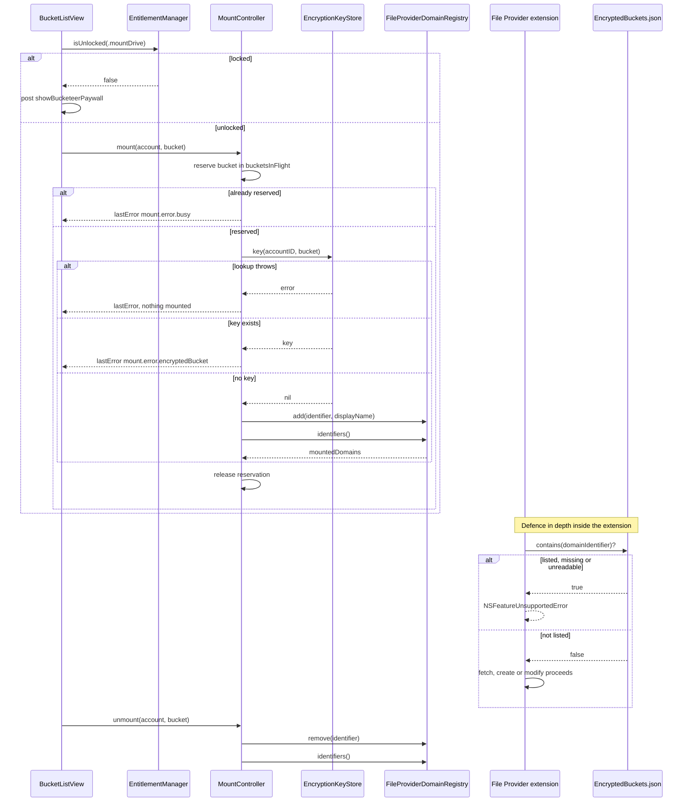

### 3.2 Server changes and Finder save conflicts

S3 and Azure have no change feed. `FinderChangeTracker` (Core actor;
the extension keeps one shared instance with one JSON file per domain
in its Application Support) keeps a `FinderChangeState` (Core, pure):
the sync anchor, every folder prefix Finder has enumerated, a revision
counter, and the key → ETag baseline of what the system was given —
the last change listing plus every page a folder enumeration delivered
since (`record`). Recording a page widens the baseline but does not
move the anchor. Each item's `contentVersion` is its ETag.

- **Server → Finder:** refreshing a bucket in the browser calls
  `BrowserViewModel.onBucketRefresh` → `MountController.signalServerChanges`
  → `signalEnumerator(for: .workingSet)` on mounted domains only. The
  working-set enumerator lists all tracked prefixes again, diffs them
  against the baseline and reports `didUpdate` / `didDeleteItems`.
  Only the listed prefixes are replaced, so a folder tracked during
  the listing is neither lost nor reported. Before committing, the
  tracker re-reads the state: a superseded anchor or a cancelled
  request commits nothing (`syncAnchorExpired`), a changed revision
  (items recorded meanwhile) means listing again, at most three times.
  An unknown anchor answers `syncAnchorExpired`, so the system lists
  everything again. Folder enumerators always answer
  `syncAnchorExpired` to change requests.
- **Finder → server:** `modifyItem` writes contents against the
  original key first. A HEAD compares `baseVersion.contentVersion`
  with the server ETag; only on a match is the write sent, with
  If-Match. Mismatch, a missing object or HTTP 412 turn the edit into
  a conflict copy next to the original, created with
  If-None-Match: * under `<name> (conflict <date> <tag>).<ext>` (a taken
  name is retried with a fresh tag); the item keeps the server version
  and is fetched again. After an accepted write the HEAD supplies
  metadata only: if it shows another ETag than the write answered
  with, somebody wrote after us and the item is fetched again.

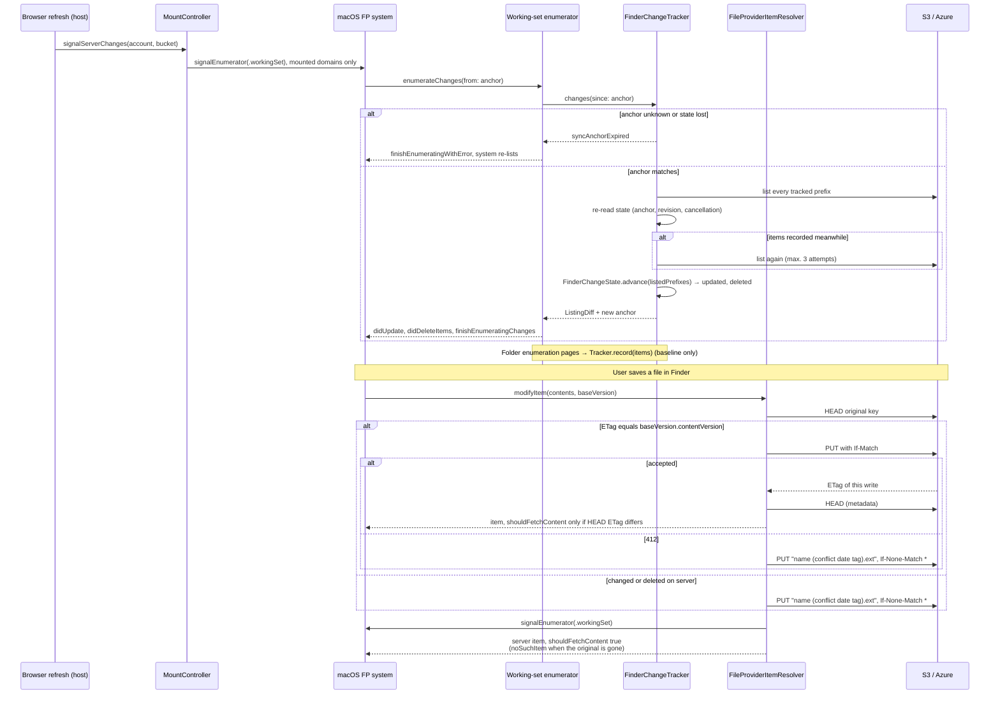

---

## 4. Entitlement state machine (Phase B)

Two non-consumable products: `pro.lifetime` (paid) and `pro.trial`
(price Free). `ProAccessResolver` (Core, pure) maps the verified
transactions of both plus the current time to `lifetime`,
`trial(endsAt)`, `trialEnded` or `trialAvailable`; `EntitlementManager`
(host, `@MainActor @Observable`) feeds it from
`Transaction.currentEntitlements` with an injectable clock. Nothing
about the trial is stored locally: the trial runs 14 days from the
trial transaction's `originalPurchaseDate`, so Restore Purchases brings
it back and deleting app data cannot restart it. The trial compares
Apple's purchase date with the Mac's clock.

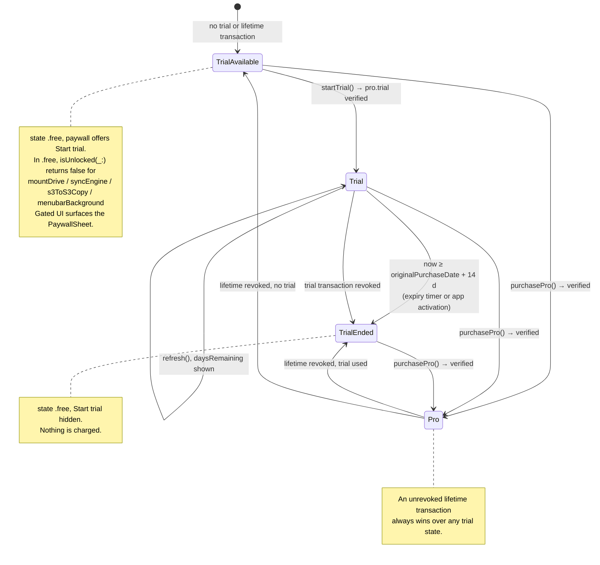

### 4.1 StoreKit purchase, restore and offer codes

All three paths end in `EntitlementManager.refresh()`, which reads
`Transaction.currentEntitlements` and then calls `onStateChange`;
`AppContainer` uses that hook to switch off menu bar mode once Pro
lapses and to write `FinderWriteAccess` to the App Group defaults: until
when mounts accept changes (the trial end during a trial, so they lock
on time even while the app is not running). Existing Finder mounts are
not removed, because that would drop changes not uploaded yet; once
that date has passed, the File Provider extension refuses creating,
deleting, renaming, moving and writing contents, and reading keeps
working. `Transaction.updates` is observed for the app's lifetime, so
purchases completed outside the paywall (another device, Family
Sharing, a redeemed code, Ask to Buy) unlock Pro without a restart.
The trial length lives only in `ProAccessResolver`. The paywall shows
the trial card only while `isTrialAvailable` is true and both products
have loaded, because the card states the Pro Lifetime `displayPrice`
before the trial starts.

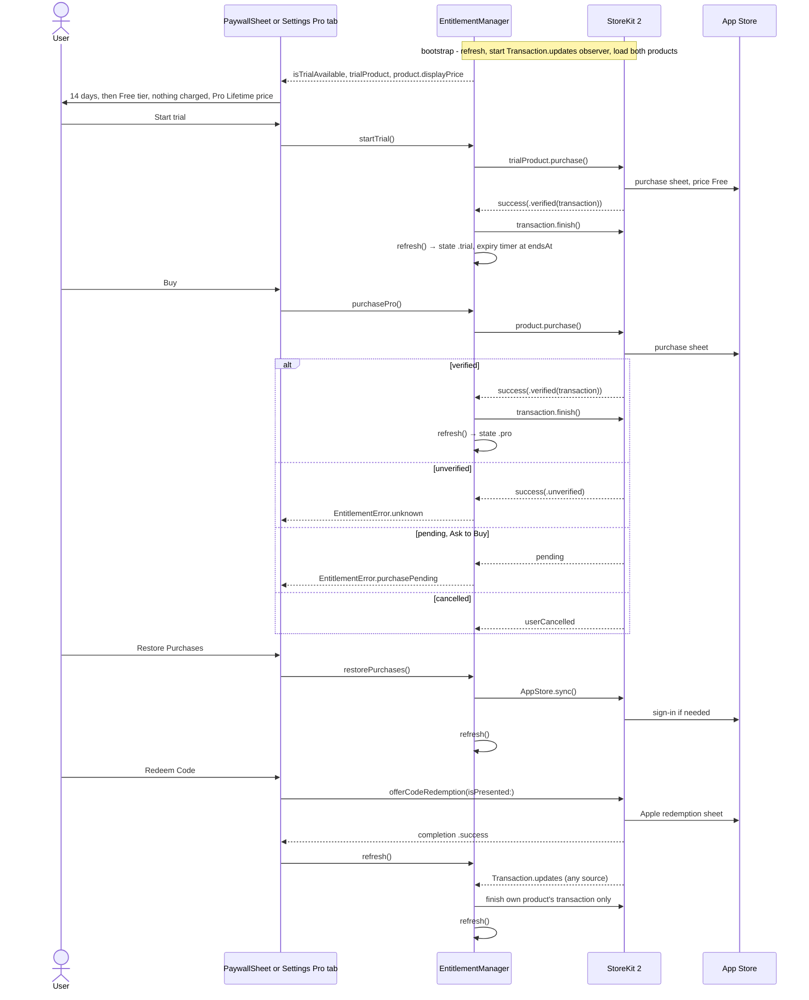

---

## 5. Account add / edit transactional flow

Saves Keychain first, then SwiftData. Rollback
distinguishes edit (restore previous credentials) from create
(delete the new orphan).

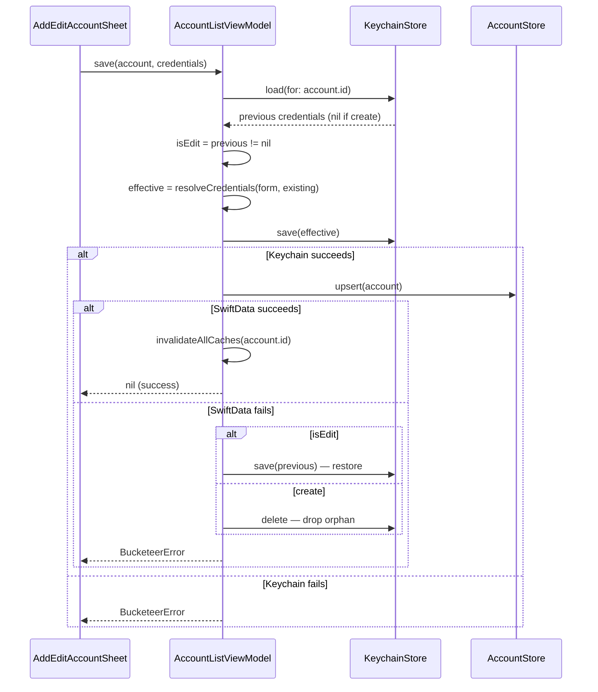

### 5.1 Touch ID reveal of stored credentials

The edit sheet opens with empty secret fields. Stored values are only
loaded after LocalAuthentication succeeds with
`.deviceOwnerAuthentication` (Touch ID, or the Mac password as
fallback). Any evaluation failure other than "this Mac has no password
at all" keeps the secret hidden. Saving with untouched fields keeps
the Keychain values (`AccountListViewModel.mergeCredentials`).

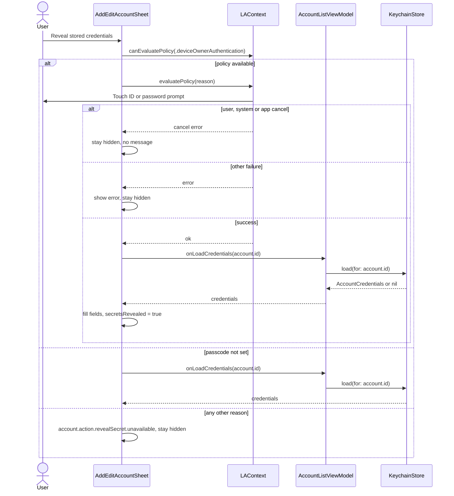

---

## 6. Multipart transfer flow (Soto / Azure / resumable / encrypted)

`TransferManager` is the actor-backed queue with bounded
concurrency, the snapshot stream the UI consumes, and the per-ID
`awaitCompletion(id:)` API the sync engine + drag-drop coordinator
suspend on. Cancellation routes through `setState` so waiters get
resumed. The 13.x block layered three
optional transforms on top: bandwidth throttling, transparent
client-side encryption, and resumable multipart uploads.

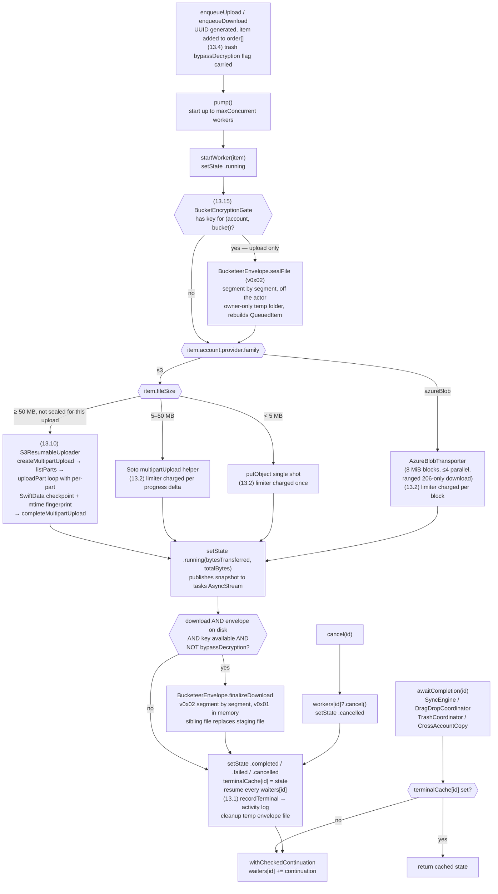

### 6.1 Trash, cross-account, auto-tag co-tenants

Three host services hang off the same TransferManager + activity-log
bus. None of them ever bypass the encryption gate or the bandwidth
limiter unless they explicitly opt in (e.g. trash capture sets
`bypassDecryption: true` so the local cache holds the raw envelope
instead of plaintext).

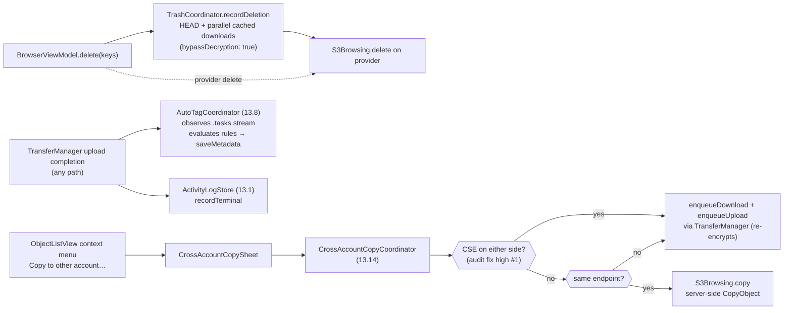

### 6.3 Open / Open With round-trip

`OpenWithController` (host) downloads an object into a folder of
`OpenWithWorkspace` (Core; temp folder per launch and per file, with a
manifest: object, base ETag, digest of the bytes equal to that
version), opens it with `NSWorkspace`, and watches it with
`FileChangeWatcher` (DispatchSource on file and folder, re-armed after
atomic saves). Saves are debounced by 2 s and handed to
`OpenWithRoundTrip` (Core actor), which serialises syncs per file,
skips events whose SHA-256 digest did not change and keeps the
manifest current. Uploads go through `OpenWithTransferRemote` →
`TransferManager.uploadConditionally`, so the encryption gate applies.
The next base is the ETag the write itself answered with, never a
later HEAD. On S3 the conditional write is a single PUT with If-Match
or If-None-Match: * (5 GiB single-PUT cap); on Azure the condition is
sent on Put Blob and Put Block List. Conflict copies are created with
If-None-Match: * under a name with a random tag.

Closing (editor quits, Bucketeer quits) runs a final sync; the temp
copy is deleted only if that sync succeeded and the bytes still equal
what the server acknowledged. Anything else moves to
Application Support/OpenWithRecovery and is offered as Upload Again
(against the original base) / Save a Copy… / Discard Edit / Later.
At launch, crash survivors whose bytes differ from their manifest
move to recovery before old folders are removed. Quitting with kept
edits asks Quit / Don't Quit.

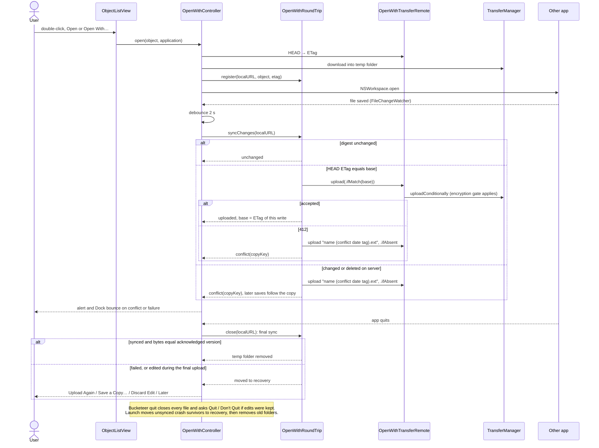

### 6.2 Client-side encryption key lifecycle

One AES-256 key per (account, bucket). Metadata lives in the host's
`BucketeerEncryptionKeys.store` (SwiftData), the raw 32 bytes in the
Keychain (`kSecAttrAccessibleWhenUnlocked`, not synchronizable). The
key never leaves the Mac and cannot be exported; losing it makes the
bucket's envelopes unreadable. There is no rotation in 1.0: creating
a second key for the same bucket is refused.

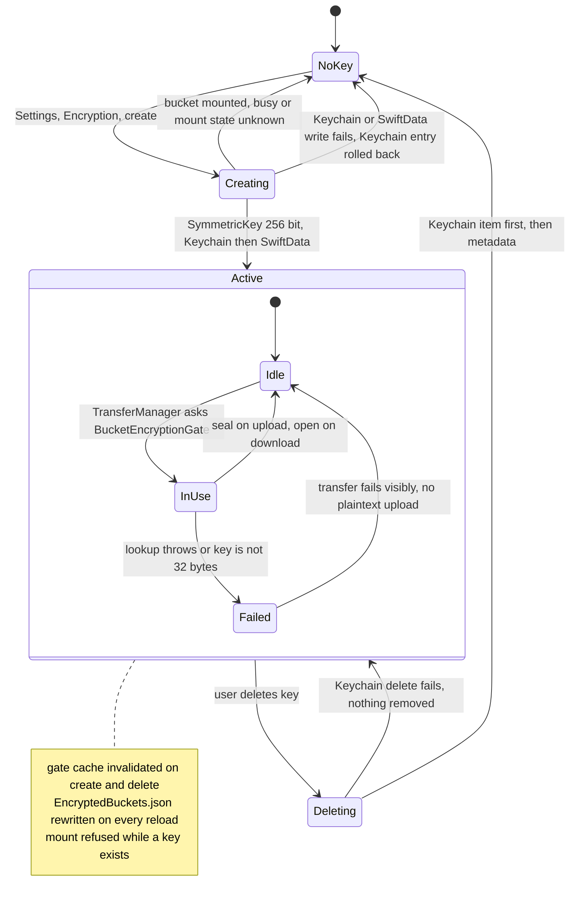

### 6.4 Encryption envelope

Every encrypted object starts with the magic `BCKT` (`42 43 4B 54`) and
a version byte. Objects carry the marker `bucketeer-enc: 1` (S3) or
`bucketeerenc: 1` (Azure) in their metadata, written on every encrypted
upload of either version; detection (#40) trusts the marker, and
authenticates unmarked objects that start with `BCKT` before treating
them as encrypted. Unmarked bytes with an invalid structure (unknown
version, impossible length, out-of-range segment size) are plain
objects; a failed tag check always fails closed. Integers are big-endian.

**Version 0x01** (read only since #39; one GCM message, decrypted in memory)

| Offset | Size | Field |
|---|---|---|
| 0 | 4 | magic `BCKT` |
| 4 | 1 | version `0x01` |
| 5 | 3 | reserved, `00 00 00` |
| 8 | 12 | AES-GCM nonce, random |
| 20 | N | ciphertext of the whole payload |
| 20 + N | 16 | GCM tag |

Key: the 32-byte bucket key. AAD: bytes 0–7. Length: `36 + P`.

**Version 0x02** (written since #39; segmented, memory bounded by the segment size)

| Offset | Size | Field |
|---|---|---|
| 0 | 4 | magic `BCKT` |
| 4 | 1 | version `0x02` |
| 5 | 3 | reserved, `00 00 00` |
| 8 | 4 | segment size `S` in plaintext bytes (UInt32; written as 1 MiB, accepted 64 B … 16 MiB) |
| 12 | 32 | salt, random per object |
| 44 | 7 | nonce prefix, random per object |
| 51 | … | segments `0 … n−1` |

- Subkey: `K = HKDF-SHA256(ikm: bucket key, salt: salt, info: "Bucketeer envelope v2 segment key", 32 bytes)`.
  A fresh subkey per object keeps nonces from repeating across objects.
- Segment `i`: `ciphertext_i ‖ tag_i` (16-byte tag), AES-256-GCM under `K`.
  Segments `0 … n−2` hold exactly `S` plaintext bytes; the final segment holds
  `1 … S` bytes, or `0` when it is the only one (empty payload).
- Position: `pos_i = UInt32(i) ‖ final_i`, where `final_i` is `01` for the last segment and `00` otherwise.
- Nonce: `nonce prefix (7) ‖ pos_i (5)` = 12 bytes.
- AAD: `header (bytes 0–50) ‖ pos_i`.
- Segment count: `n = max(1, ⌈P / S⌉)`; length: `C = 51 + P + 16·n`.
- Inverse (reader): `B = C − 51`, `n = ⌈B / (S + 16)⌉`, last segment length
  `L = B − (n − 1)(S + 16)`, valid only if `B ≥ 16` and `L ≥ 17` for `n > 1`
  (`L ≥ 16` for `n = 1`); then `P = B − 16·n`. Any other length is malformed.

Because the index and the final flag are in both nonce and AAD, a
reordered, duplicated or dropped segment fails its tag; cutting the
envelope after a segment boundary turns a non-final segment into the
last one and fails, cutting inside a segment leaves a final segment
that fails, and appended bytes make the real final segment non-final.
Changing any header byte changes the AAD (and, for the salt, the
subkey). Segments are authenticated one by one, so a truncated object is
only detected at its end: `finalizeDownload` decrypts into a sibling
file and replaces the staged download only after the last segment
authenticated; a failure removes the partial output.

Uploads seal into an owner-only folder under the temp directory
(`BucketeerEncryptedUploads/<UUID>/`), removed when the upload ends for
any reason. Such uploads do not use the resumable uploader: resuming
requires the identical ciphertext, but each attempt draws a new salt
and nonce prefix, and deriving them deterministically from the file
would reuse nonces whenever a file changes without changing its
fingerprint. They take the multipart path of `S3FileUpload` instead,
which reads part by part and aborts the upload on failure. Previews
and the trash restore check authenticate segment by segment without
writing plaintext.

Every envelope upload, a fresh seal or a trash restore of a cached
envelope, is stored with `Content-Type: application/octet-stream`
(`x-ms-blob-content-type` on Azure block-list commits), so the stored
type does not reveal the plaintext's file type (#45). Only the object
body is encrypted: object names, keys (paths) and sizes stay plaintext,
and an envelope is `51 + P + 16·n` bytes long (`36 + P` for 0x01), so
the plaintext size can be derived from it.

---

## 7. Provisioning and signing topology

What lives where (App Sandbox + entitlements + provisioning):

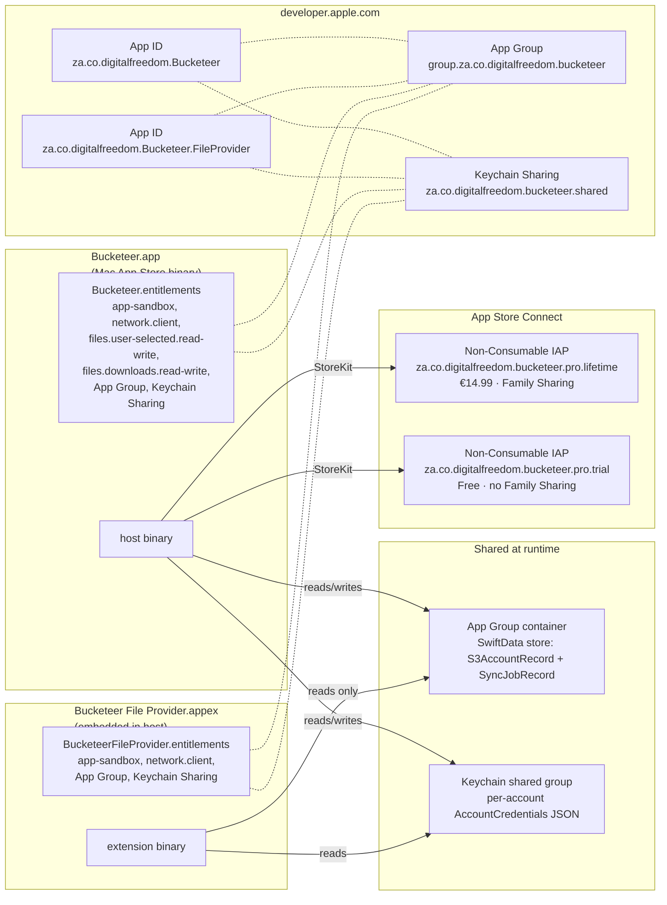

---

## 8. Test architecture

Tests live in `BucketeerCore/Tests/BucketeerCoreTests/`. `swift test`
runs them in ~25 ms; no Xcode test target is required.

| Suite | Tests | What it locks |
|---|---|---|
| `AzureSharedKeySigner` | 10 | StringToSign construction, canonical headers/resource, GET vs PUT Content-Length, signed Authorization shape |
| `AzureRequestBuilder` | 9 | URL composition, slash preservation, percent encoding, block-ID equal-length invariant, blockListXML body |
| `AzureListXMLParser` | 6 | container listing, blob listing with BlobPrefix + NextMarker, error envelope parse |
| `S3ClientFactory.endpoint` | 12 | per-provider URL templates (AWS, Civo, R2, B2, Wasabi, DO, Storj, Azure default + sovereign, Custom) |
| `S3Provider` | 11 | defaults, family routing, picker visibility flags, accountID requirements |
| `SyncPlanner` | 19 | plan computation, prefix relocation, name+size vs name+ETag, mirror deletes respect globs, 5 local-folder cases |
| `ProAccessResolver` | 11 | lifetime wins, trial window from originalPurchaseDate, expiry boundary, revoked trial and lifetime, earliest trial, unknown products, days remaining |
| `OpenWithRoundTrip` + `ConflictCopyName` | 19 | no-op saves skipped, If-Match upload, next save on the write's own ETag, foreign write right after our upload not adopted, 412 / changed / deleted → create-only conflict copy, two same-second conflicts keep both copies, taken names retried (bounded), saves follow the copy, unregistered files, quoted ETags, copy-name dot rules, random tags |
| Open With recovery (`OpenWithWorkspace`, `close`, `retry`) | 8 | clean close removes, offline save kept with object + base ETag, edit during the final upload kept, crash survivor kept / clean leftover removed, synced file not taken for a survivor, retry against original base, failed retry stays, discard |
| `FinderChangeState` + `ETag.matches` | 10 | updated / deleted diff, quoted ETags, anchor, tracked prefixes, vanished folders pruned, partial listing keeps other prefixes, record bumps revision, unknown base or missing object never matches |
| `FinderChangeTracker` | 6 | deletion after folder enumeration, paginated folder, folder recorded during a listing (suspended lister), two requests from one anchor, cancelled request, unknown anchor |
| `LocalFolderWriter.safeChildURL` | 6 | empty / absolute / `..` / `.` / legitimate paths |
| `BandwidthLimiter` (13.2) | 5 | unlimited fast-path, sub-burst, deficit-sleep loop, mid-flight toggle, `currentLimit` |
| `BucketStatsCollector` + `ProviderPricing` (13.5) | 6 | top-N maintenance, every provider rate, AWS GB precision, zero bytes |
| `AutoTagRuleEvaluator` (13.8) | 6 | empty list, disabled rules, empty-matches-all, `*`/`?` glob, case-insensitive MIME prefix, merge order |
| `BucketeerDeepLink` (13.11) | 9+4 | grammar round-trip per case, prefix variants, bad UUID, missing bucket, case-insensitive scheme, percent-encoded key, query string ignored |
| `BucketeerEnvelope` (13.15 + audit fix) | 9 | round-trip, header layout, wrong-key auth fail, garbage reject, prefix detection, tamper detection, **empty plaintext** (audit low #1), **version tamper** + **reserved tamper** (audit medium #1) |
| `StreamingEnvelope` (#39) | 4 | 64 MiB file round trip with per-call I/O bounded by one segment, v0x01 and v0x02 fixtures written outside the app, truncation / reorder / append / bit flip / header changes fail and leave the download untouched, segment boundaries 0, 1, S, 2S, 2S+1 |
| `TrashedItem.displayName` | 4 | multi-segment, single-segment, empty, trailing-slash folder-style |
| **Total, all Core suites incl. those not listed** | **164** | test functions as of 2026-11-02 |

Pure logic that lived in host classes was extracted to Core in three
waves (SyncPlanner, trial rules, LocalFolderWriter) and then
incrementally per 13.x phase whenever the work was deterministic
(envelope, evaluator, fingerprint, parser). Core tests run in ~3 s
end-to-end; no Xcode test target is required.

---

## 9. Source-of-truth map

| Concern | File / dir |
|---|---|
| Composition root + SwiftData store URL migration | `Bucketeer/Services/AppContainer.swift` |
| App lifecycle (Window, MenuBarExtra, AppDelegate) | `Bucketeer/App/BucketeerApp.swift` |
| Provider endpoint matrix | `BucketeerCore/Sources/BucketeerCore/Models/S3Provider.swift` + `S3/S3ClientFactory.swift` |
| Azure signing | `BucketeerCore/Sources/BucketeerCore/Services/Azure/AzureSharedKeySigner.swift` |
| Per-family routing | `BucketeerCore/Sources/BucketeerCore/Services/ProviderRouter.swift` |
| Sync routing (4 paths) | `Bucketeer/Services/Sync/SyncEngine.swift` |
| Sync planning (pure) | `BucketeerCore/Sources/BucketeerCore/Services/Sync/SyncPlanner.swift` |
| Path-traversal guard | `BucketeerCore/Sources/BucketeerCore/Services/Sync/LocalFolderEnumerator.swift` (`LocalFolderWriter.safeChildURL`) |
| Trial and Pro access rules | `BucketeerCore/Sources/BucketeerCore/Services/Entitlements/ProAccessResolver.swift` + `Bucketeer/Services/Entitlements/EntitlementManager.swift` |
| Open With round-trip and recovery | `BucketeerCore/.../Services/OpenWith/OpenWithRoundTrip.swift` + `OpenWithWorkspace.swift` + `ConflictCopyName.swift` + `Bucketeer/Services/OpenWith/*.swift` |
| Finder change tracking and save conflicts | `BucketeerCore/.../Services/OpenWith/FinderChangeState.swift` + `FinderChangeTracker.swift` + `Bucketeer File Provider/FinderChangeTracker.swift` (shared instance) + `FileProviderItemResolver.swift` (`modifyItem`) |
| File Provider host coordinator | `Bucketeer/Services/MountController.swift` |
| File Provider extension | `Bucketeer File Provider/*` |
| Per-phase changelog | `CHANGELOG.md` |
| Manual setup checklist | `PHASE_9_SETUP.md` |
| App Store metadata draft | `docs/APP_STORE_METADATA.md` |
| Deep-link scheme + Info.plist requirement | `docs/DEEP_LINKS.md` |
| Audit log storage + recording hooks | `BucketeerCore/.../Services/Activity/ActivityLogStore.swift` + per-service `record(...)` calls |
| Soft-delete trash + cached restore | `BucketeerCore/.../Services/Trash/TrashStore.swift` + `Bucketeer/Services/Trash/TrashCoordinator.swift` |
| Resumable multipart upload | `BucketeerCore/.../Services/S3/S3ResumableUploader.swift` + `CheckpointStore.swift` |
| Client-side encryption envelope + key store | `BucketeerCore/.../Services/Encryption/ObjectEncryptor.swift` + `EncryptionKeyStore.swift` + `Bucketeer/Services/Encryption/BucketEncryptionGate.swift` |
| Bandwidth throttle | `BucketeerCore/.../Services/Transfers/BandwidthLimiter.swift` + `Bucketeer/Services/Transfers/BandwidthSettings.swift` |
| Auto-tag rule engine | `BucketeerCore/.../Services/AutoTag/AutoTagRuleEvaluator.swift` + `Bucketeer/Services/AutoTag/AutoTagCoordinator.swift` |
| Bucket dashboard + insights | `BucketeerCore/.../Services/Stats/BucketStatsCollector.swift` + `ProviderPricing.swift` + `Bucketeer/Views/Browser/BucketDashboardSheet.swift` |
| Cross-account copy / move | `Bucketeer/Services/CrossAccount/CrossAccountCopyCoordinator.swift` |
| `bucketeer://` deep links | `BucketeerCore/.../Services/DeepLink/BucketeerDeepLink.swift` + `Bucketeer/Services/DeepLink/DeepLinkRouter.swift` |
| App Intents (Shortcuts / Siri) | `Bucketeer/Services/AppIntents/*.swift` |
| Spotlight indexing | `Bucketeer/Services/Spotlight/SpotlightIndexer.swift` + `SpotlightSettings.swift` |
| Hardware-key detection (preview, Debug-only until v1.1) | `Bucketeer/Services/HardwareKey/HardwareKeyAvailability.swift` + `HardwareKeySettings.swift` |
